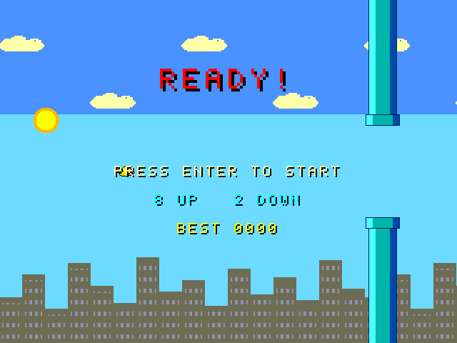
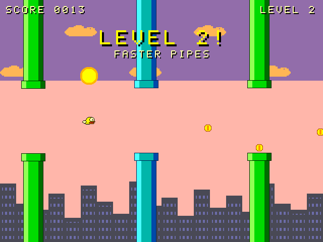
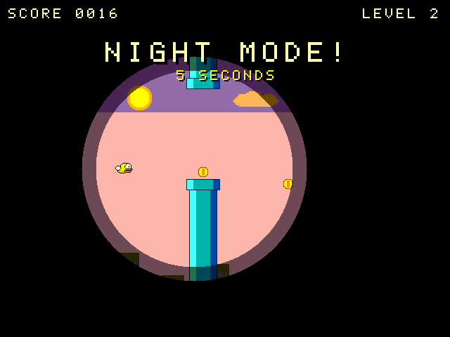
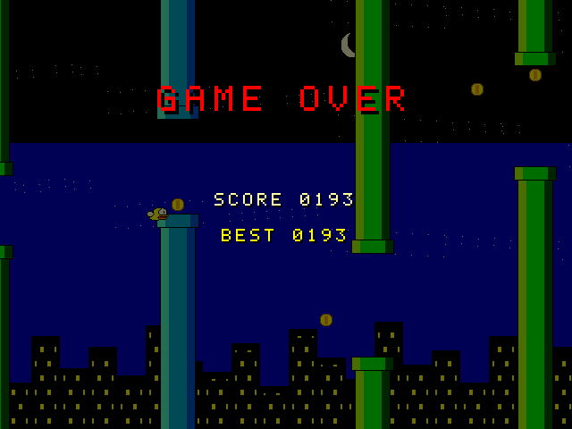
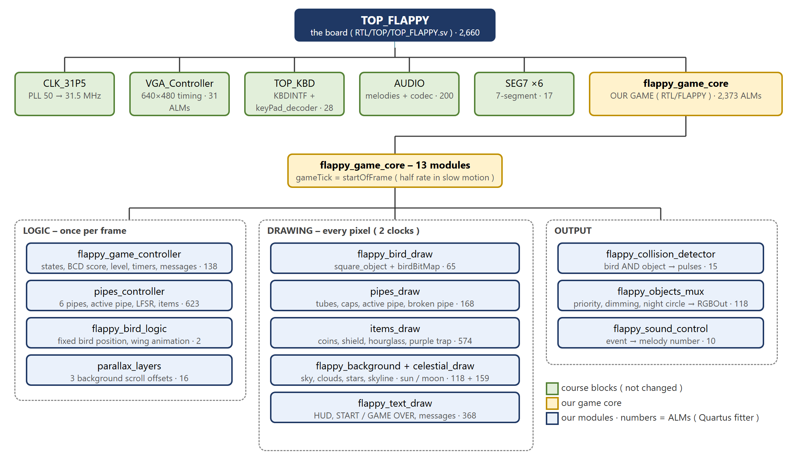
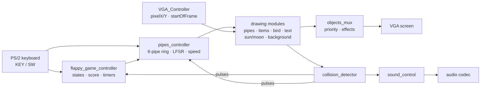
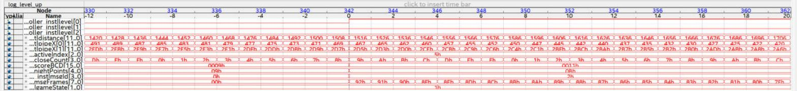
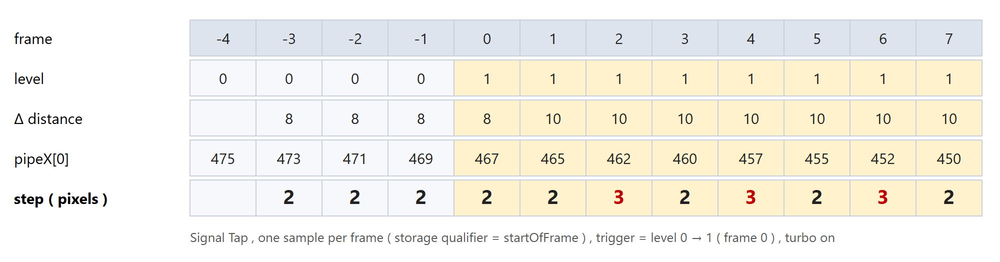

# Flappy Bird – Controlled Maze 🐦

**A real-time video game on an FPGA, written in SystemVerilog.**
Technion – Electrical Engineering Lab 1A (044157) · DE10-Standard board (Intel Cyclone V) · 2026

In the usual Flappy Bird the bird flies through the pipes. Here it is the other way round: **the bird stays still, the world scrolls, and the player moves the pipes** so that the gap reaches the bird.

<p align="center">
  
  
</p>
<p align="center">
  
  
</p>

<!-- add a short video of the game on the board here : [▶ Demo video](https://...) -->

---

## Features

- **640×480 VGA at 72 Hz**: every pixel is computed in real time, with no frame buffer
- **Controlled maze**: only the *active* pipe (teal) moves with the keys (numpad 8 / 2); all the other pipes keep scrolling
- **Score and levels**: +1 for every pipe, +2 for a coin. The level is the tens digit of the score, and each new level brings faster pipes, a smaller distance between them and faster keys
- **Challenges**:
  - from level 3 the maze disappears for 1 second every 25 seconds, and it still kills
  - from level 4 the pipes slowly close in, but the gap never gets smaller than 64 px
  - every 15 points there is a night mode, where you only see a circle in front of the bird
- **Items**: a shield (breaks one pipe), an hourglass (slow motion), a purple trap (the keys swap)
- **Graphics**: a 3-layer parallax background, a day → sunset → night cycle, the sun and the moon moving on an arc, and a pixel font with shadows
- **Sound**: a melody for every event, played through the board's audio codec
- Score and best score on the **7-segment displays**, and the game state on the **LEDs**

---

## Architecture

<p align="center"></p>

The design runs on **one 31.5 MHz clock**. Everything that changes over time uses enables, not extra clocks:



| Group | Modules | Runs |
|---|---|---|
| **Logic** | `flappy_game_controller`, `pipes_controller`, `flappy_bird_logic`, `parallax_layers` | once per frame |
| **Drawing** | `pipes_draw`, `items_draw`, `flappy_bird_draw` + `birdBitMap`, `celestial_draw`, `flappy_background`, `flappy_text_draw` | every pixel, 2-clock pipeline |
| **Output** | `flappy_collision_detector`, `flappy_objects_mux`, `flappy_sound_control` | every pixel / every event |

### Design ideas

| Idea | How |
|---|---|
| **Collision without geometry** | A hit is the AND of two drawing requests in the same pixel, so it is pixel-accurate. Every drawing module has the same 2-clock latency, so the requests always refer to the same pixel |
| **Ring of 6 pipes** | A pipe that leaves on the left is placed again behind the last pipe, with new random values. The active pipe is just an index, 0..5 |
| **Fixed-point speed** | The distance is counted in quarter pixels, so a speed of 1.25 px/frame gives steps of 1, 1, 1, 2 |
| **Randomness** | A 16-bit LFSR (taps 16/14/13/11). The seed is taken at the moment ENTER is pressed, then each new pipe advances it 24 steps |
| **BCD score** | The score is added digit by digit with a carry. The level is the tens digit, and the digits go straight to the 7-segment displays and the font |
| **Circles without square roots** | A pixel is inside a circle when dx² + dy² < R² (used for the night spotlight, the shield ring, the coins and the moon) |
| **Slow motion** | `gameTick` lets every 2nd frame through to the moving parts, while the timers still count real seconds |

---

## Verification

- **13 module testbenches** (Icarus Verilog) with **over 5 million automated checks**, most of them per pixel. All of them pass
- **Verilator lint** (`-Wall`) is clean on all modules
- A **full-game simulation** (Verilator) plays the whole game and writes the screenshots above. 22 out of 22 checks pass
- **On-board debugging with Signal Tap**: the storage qualifier is `startOfFrame`, so the analyzer keeps **one sample per frame**. 1024 samples then cover about 14 seconds of gameplay instead of 32 µs. This was used to measure the pipe speed at a level change: 2.5 px/frame shows up as steps of 2, 3, 2, 3

<p align="center">
  <br>
  
</p>

## Results (Quartus Prime 17.0 Lite)

| | |
|---|---|
| Device | Cyclone V 5CSXFC6D6F31C6 (DE10-Standard) |
| Logic | **2,660 ALMs (6%)** · 1,288 registers · 41 DSP blocks · 32,768 memory bits · 1 PLL |
| Timing | Meets timing at 31.5 MHz: **setup slack +5.2 ns**, hold slack +0.22 ns |

---

## Controls

| Input | Action |
|---|---|
| **ENTER** (numpad) | start / restart |
| **Numpad 8 / 2** (or KEY[2] / KEY[1]) | move the active pipe up / down |
| KEY[2] + KEY[1] together | start without a keyboard |
| KEY[3] | volume · KEY[0] reset |
| SW[0] / SW[1] / SW[4] | no-death mode / turbo / show the best score |

## Repository

```
RTL/FLAPPY/    the 15 game modules (flappy_game_core connects them)
RTL/TOP/       TOP_FLAPPY - the board top level
constraints/   flappy.sdc (timing) · flappy_pins.tcl (pins)
sim/           testbenches · run_checks.ps1 (lint + tests) · run_core.ps1 (full game)
tools/         helper scripts (qsf generator, font tables, ppm → png)
```

### Course files (not included)

The board interface blocks are the course's **Lab1Demo** files, used **unchanged**: the `CLK_31P5` PLL, `VGA_Controller`, `square_object`, the PS/2 keyboard (`TOP_KBD`, `KBDINTF`), the `AUDIO` block and `SEG7`. They belong to the Technion EE Labs and are **not part of this repository**. To build the project, copy them from Lab1Demo into `RTL/VGA`, `RTL/KEYBOARDX`, `RTL/AUDIO` and `RTL/Seg7`, put `CLK_31P5.*`, `KBDINTF.qxp` and `audio_codec_controller.QXP` in the root folder, and open `FlappyBird.qpf` in Quartus.

---

**Author:** Mohammad Maheliah · Technion Electrical Engineering, Lab 1A, 2026 (a two-student team project)
